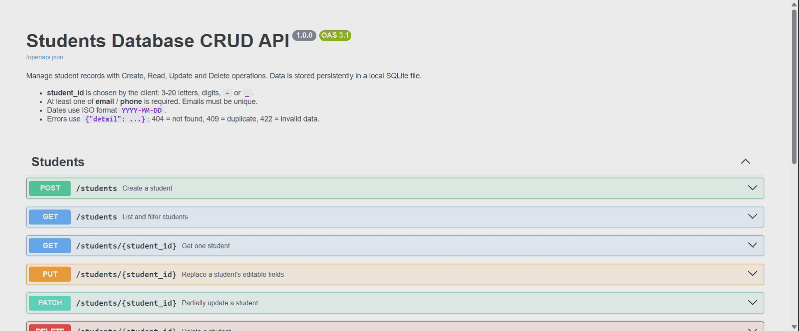

# Students Database CRUD Application

A backend REST API for managing student records (Create, Read, Update, Delete), built with **Python**, **FastAPI** and **SQLite** (via SQLAlchemy 2.x).

**Author:** Vedant Vinod Rakshe;|&nbsp; **AICTE Student Portal ID:**  STU686536be18ef01751463614 &nbsp;|&nbsp; **Intership:**  EWB/AI & ML

   

## Preview




## Table of contents
1. [Overview](#1-overview)
2. [Features](#2-features)
3. [Requirements checklist](#3-requirements-checklist)
4. [Technology stack](#4-technology-stack)
5. [Project structure](#5-project-structure)
6. [How it works](#6-how-it-works)
7. [Database schema and validation rules](#7-database-schema-and-validation-rules)
8. [API reference](#8-api-reference)
9. [Setup on Windows](#9-setup-on-windows-powershell)
10. [Run the application](#10-run-the-application)
11. [Seed sample data](#11-seed-sample-data-optional)
12. [Try the API](#12-try-the-api)
13. [Run the tests](#13-run-the-automated-tests)
14. [Reset the database](#14-reset-the-development-database)
15. [Troubleshooting](#15-troubleshooting)
16. [Privacy and security](#16-privacy-and-security)
17. [Limitations and future work](#17-limitations-and-future-enhancements)

## 1. Overview
Schools need a simple, reliable way to store and maintain student records. This project provides a REST API that does this with validated input, permanent storage in a local SQLite file, clear error responses and interactive documentation. No frontend, Docker, API keys or external services are needed.

**Objectives**
- Implement full CRUD for students through a REST API.
- Store data permanently in SQLite and create the database automatically.
- Validate every input and return correct HTTP status codes.
- Provide automated tests that never touch the development database.

## 2. Features
- Create, list, view, replace (PUT), partially update (PATCH) and delete students
- Filtering by name, course, email and date of birth, plus pagination (`limit`, `offset`)
- Strict validation of IDs, names, dates, emails and phone numbers
- Duplicate protection for student ID and email
- Failed updates never change the stored record
- Interactive docs: Swagger UI (`/docs`) and ReDoc (`/redoc`); opening `/` redirects to `/docs`
- Health check endpoint and generic 500 errors that never expose internals
- Seed script with fictional data
- 113 automated tests, each using its own temporary database

## 3. Requirements checklist
| Requirement | Status |
|---|---|
| `POST /students` create with validation and duplicate check | Done |
| `GET /students` list, filters, pagination, empty list | Done |
| `GET /students/{student_id}` with 404 when missing | Done |
| `PUT` and `PATCH /students/{student_id}` | Done |
| `DELETE /students/{student_id}` returns 204, 404 when missing | Done |
| Persistent SQLite file, tables created automatically | Done |
| Parameterised queries (SQLAlchemy) | Done |
| Pydantic schemas separate from database models | Done |
| Swagger UI and ReDoc | Done |
| Automated tests with an isolated database | 113 passed |
| Ollama AI extension | Not implemented (optional bonus) |

## 4. Technology stack
Python 3.10+, FastAPI, Uvicorn, SQLAlchemy 2.x (SQLite), Pydantic v2 with `email-validator`, pytest, httpx.

SQLAlchemy was chosen because it sends parameterised queries (which prevents SQL injection), keeps models separate from logic, and works well with FastAPI's dependency system.

## 5. Project structure
```
students-database-crud/
├── app/
│   ├── main.py            # FastAPI app, start-up (creates DB), /health, error handler
│   ├── database.py        # engine, sessions, init_db(), database path
│   ├── models.py          # SQLAlchemy table (Student)
│   ├── schemas.py         # Pydantic request/response schemas and validation
│   ├── crud.py            # all database operations
│   ├── dependencies.py    # get_db session dependency
│   └── routers/
│       └── students.py    # HTTP routes
├── tests/
│   ├── conftest.py        # temporary-database fixtures
│   └── test_students.py   # 113 tests
├── scripts/
│   └── seed_data.py       # fictional sample data
├── docs/                  # screenshots / demo GIF (optional)
├── requirements.txt
├── .env.example
├── .gitignore
└── README.md
```
The `data/` folder (containing `students.db`) is created automatically on first start and is not part of the repository.

## 6. How it works
```
Client -> Router -> Pydantic validation -> CRUD functions -> SQLAlchemy session -> SQLite file
```
- Routers (`routers/students.py`) deal only with HTTP.
- `schemas.py` validates all input.
- `crud.py` runs all database operations. Writes are committed on success and rolled back on failure.
- Each request gets its own database session, which is always closed afterwards.

## 7. Database schema and validation rules
Table `students`:

| Field | Type | Null? | Rules |
|---|---|---|---|
| `student_id` | TEXT(20), primary key | no | Chosen by the client: 3-20 letters, digits, `-` or `_`. Case-sensitive. Cannot be changed. |
| `name` | TEXT(100) | no | Trimmed, not blank, must contain a letter |
| `date_of_birth` | DATE | no | `YYYY-MM-DD`, a real date, not in the future |
| `email` | TEXT(254), unique | yes | Valid email, stored in lower case |
| `phone` | TEXT(20) | yes | 7-15 digits; may include `+ ( ) -` and spaces |
| `course` | TEXT(100) | yes | Trimmed; blank becomes null |
| `address` | TEXT(255) | yes | Trimmed; blank becomes null |
| `enrollment_date` | DATE | yes | `YYYY-MM-DD`; not before `date_of_birth` |

- **Contact policy:** at least one of `email` or `phone` is required.
- **Duplicate email policy:** emails must be unique, ignoring case; a duplicate returns `409`. Students without an email never conflict.
- **Unknown fields** in a request body are rejected with `422`, so `student_id` cannot be changed through PUT or PATCH.

## 8. API reference
| Method | Endpoint | Purpose | Success |
|---|---|---|---|
| POST | `/students` | Create a student | 201 |
| GET | `/students` | List, filter and paginate | 200 |
| GET | `/students/{student_id}` | Get one student | 200 |
| PUT | `/students/{student_id}` | Replace all editable fields | 200 |
| PATCH | `/students/{student_id}` | Change only the fields sent | 200 |
| DELETE | `/students/{student_id}` | Delete a student | 204 |
| GET | `/health` | Health check | 200 |

**List parameters:** `name` (contains, case-insensitive), `course` (contains), `email` (exact), `date_of_birth` (`YYYY-MM-DD`), `limit` (1-500, default 100), `offset` (0 or more). The number of matches is returned in the `X-Total-Count` response header.

**PUT** needs `name`, `date_of_birth` and a contact method; optional fields that are left out become null. **PATCH** changes only the fields sent and validates the final combined record; sending `null` clears an optional field.

**Status codes**
| Code | Meaning |
|---|---|
| 200 / 201 / 204 | OK / created / deleted |
| 404 | Student not found |
| 409 | Duplicate `student_id` or `email` |
| 422 | Invalid data (validation errors, malformed JSON, bad query parameters) |
| 500 | Unexpected error: `{"detail": "Internal server error"}` |

**Example: create a student** (`POST /students`)
```json
{
  "student_id": "S2024-001",
  "name": "Aarav Sharma",
  "date_of_birth": "2004-05-17",
  "email": "aarav.sharma@example.com",
  "phone": "+91 98765 43210",
  "course": "Computer Science",
  "address": "12 Example Street, Mumbai",
  "enrollment_date": "2022-08-01"
}
```
Response `201` returns the same object. Creating the same ID again returns `409` with `{"detail": "A student with this student_id already exists"}`.

**Example: partial update** (`PATCH /students/S2024-001`): `{"course": "Data Science"}`
**Example: filtered list:** `GET /students?course=computer&limit=10&offset=0`

## 9. Setup on Windows (PowerShell)
You need Python 3.10 or newer (check with `python --version`). Open the project folder in VS Code (**File > Open Folder**), then open a terminal (**Terminal > New Terminal**). Run every command from the project root, the folder that contains `requirements.txt`.

```powershell
python -m venv .venv
.\.venv\Scripts\Activate.ps1
python -m pip install --upgrade pip
pip install -r requirements.txt
```
Create the environment (`python -m venv .venv`) only once. The prompt should start with `(.venv)` after activating.

If PowerShell blocks activation, run this once and activate again:
```powershell
Set-ExecutionPolicy -Scope CurrentUser -ExecutionPolicy RemoteSigned
```

## 10. Run the application
```powershell
.\.venv\Scripts\Activate.ps1
uvicorn app.main:app --reload
```
Wait for `Application startup complete`, then open:
- http://127.0.0.1:8000/docs for Swagger UI (http://127.0.0.1:8000 redirects here)
- http://127.0.0.1:8000/redoc for ReDoc
- http://127.0.0.1:8000/health for the health check

Stop the server with `Ctrl+C`.

**Database:** at start-up the app creates `data/students.db` and the `students` table if they are missing. Existing data is never changed. The location does not depend on the current directory. To use another file, run `$env:STUDENTS_DB_PATH = "data\other.db"` before starting (relative paths start at the project root).

## 11. Seed sample data (optional)
```powershell
python scripts/seed_data.py
```
Adds five fictional students (`DEMO-001` to `DEMO-005`). Running it again skips the ones that exist. It is never run automatically, and the app works without it.

## 12. Try the API
**In Swagger UI** (http://127.0.0.1:8000/docs):
1. Open **POST /students**, click **Try it out**, then **Execute** to create the example student (`201`).
2. Run **GET /students** and **GET /students/{student_id}** with `S2024-001`.
3. Try **PATCH** and **PUT** (do not include `student_id` in the body).
4. Run **DELETE**, then **GET** the same ID again to see `404`.

**In PowerShell** (server running in another window):
```powershell
$body = '{"student_id":"S2024-001","name":"Aarav Sharma","date_of_birth":"2004-05-17","email":"aarav.sharma@example.com"}'
Invoke-RestMethod -Method Post -Uri http://127.0.0.1:8000/students -ContentType "application/json" -Body $body
Invoke-RestMethod http://127.0.0.1:8000/students
Invoke-RestMethod -Method Patch -Uri http://127.0.0.1:8000/students/S2024-001 -ContentType "application/json" -Body '{"course":"Data Science"}'
Invoke-RestMethod -Method Delete -Uri http://127.0.0.1:8000/students/S2024-001
```

## 13. Run the automated tests
```powershell
python -m pytest
```
The result when this project was submitted: **113 passed** (Windows, Python 3.12). One harmless warning about `httpx` in Starlette's test client is expected.

Each test uses its own temporary SQLite file, so `data/students.db` is never touched. The tests cover creation, reading, filters, pagination, PUT/PATCH, deletion, validation, duplicates, persistence across a simulated restart, automatic database creation, the docs endpoints and the generic 500 response.

## 14. Reset the development database
Stop the server, then:
```powershell
Remove-Item .\data\students.db
```
It is recreated empty at the next start.

## 15. Troubleshooting
| Problem | Fix |
|---|---|
| Browser shows `Not Found` at `/` | Open http://127.0.0.1:8000/docs (older versions had no page at `/`) |
| `python` is not recognised | Reinstall Python with "Add to PATH", or use `py -m venv .venv` |
| `Activate.ps1 cannot be loaded` | `Set-ExecutionPolicy -Scope CurrentUser -ExecutionPolicy RemoteSigned` |
| `Permission denied ... python.exe` | You ran `python -m venv .venv` while the environment was active. Do not repeat it; just activate and run |
| `No module named 'app'` | Run commands from the project root, not from inside `app/` |
| `No module named 'fastapi'` (or similar) | Activate `.venv`, then `pip install -r requirements.txt` |
| `Address already in use` | `uvicorn app.main:app --reload --port 8001` |
| `422` on PUT/PATCH | Remove `student_id` from the body and check the error `detail` |
| `409` | The `student_id` or `email` already exists |

## 16. Privacy and security
- Only fictional data is used. Never commit real student records.
- All queries go through SQLAlchemy (parameterised), and `%` / `_` in filters are escaped.
- Error responses never show paths, stack traces or SQL, and logs never contain student data.
- There is **no authentication**. Do not expose this API to the public internet as it is.

## 17. Limitations and future enhancements
- No authentication, frontend or database migrations (tables are created with `create_all`).
- Student IDs are chosen by the client and are not generated automatically.
- Possible future work: a local Ollama question-answering endpoint that uses only fixed, parameterised queries.
